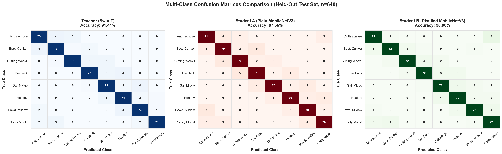
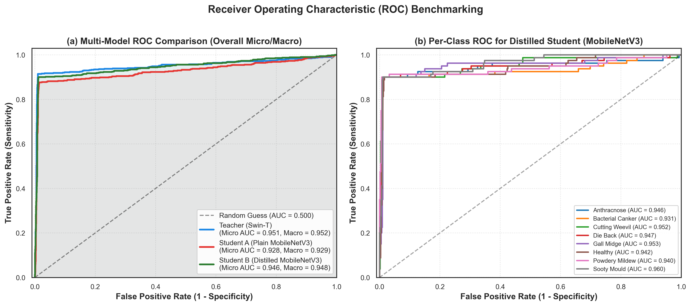
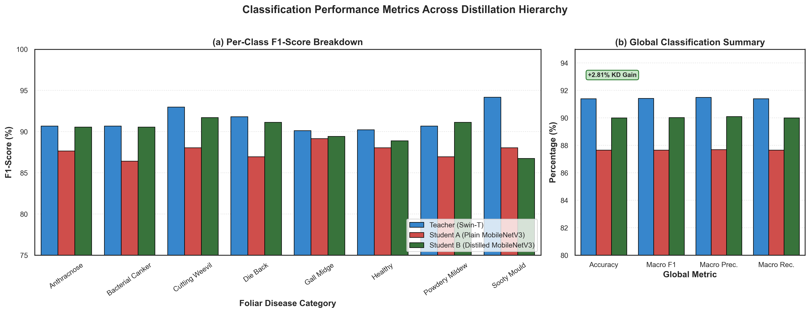
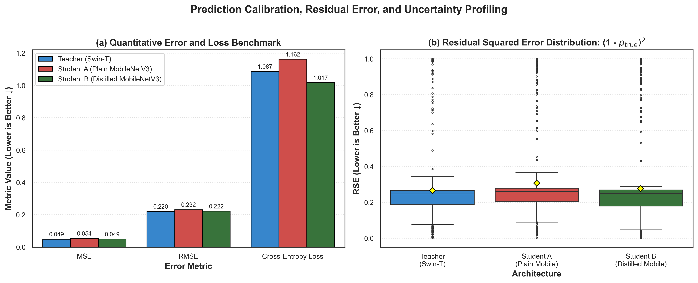

# Does Knowledge Distillation Preserve Diagnostic Reasoning?
### A Faithfulness- and Robustness-Aware Evaluation of Compressed Vision Models for Mango Leaf Disease Detection

[-blue)](https://www.sciencedirect.com/journal/smart-agricultural-technology)
[](https://pytorch.org/)
[](LICENSE)

---

## 📌 Overview
Automated foliar pathology detection in tropical orchards requires deploying vision models onto resource-constrained edge devices (budget smartphones, offline agricultural scouting units). While deep Vision Transformers (e.g., Swin Transformer) achieve high diagnostic accuracy, their parameter count ($>27\text{M}$) and inference latency ($>100\text{ ms}$) prevent real-time field deployment.

This repository implements a **cross-architecture knowledge distillation (KD) framework** transferring diagnostic representations from a **Swin Transformer Tiny (Teacher)** to an ultra-lightweight **MobileNetV3-Small (Student)** on the 8-class Mendeley Mango Leaf Disease Dataset.

Beyond raw accuracy, this investigation provides the first systematic benchmark evaluating whether **knowledge distillation preserves diagnostic reasoning (XAI faithfulness)** and whether reasoning alignment confers resilience against **real-world agricultural field corruptions**.

---

## 🏆 Model Architecture & Efficiency Benchmark

| Architecture | Role | Parameters | FLOPs | Checkpoint | CPU Latency | CPU FPS | Test Accuracy | Macro F1 |
| :--- | :---: | :---: | :---: | :---: | :---: | :---: | :---: | :---: |
| **Swin-T** | Teacher | 27.53 M | 4.371 G | 105.1 MB | 108.18 ms | 9.2 FPS | **91.41%** | **91.39%** |
| **MobileNetV3-Small** | Student A (Plain) | 1.53 M | 0.061 G | 5.95 MB | 11.21 ms | 89.2 FPS | **87.50%** | **87.42%** |
| **MobileNetV3-Small** | Student B (Distilled) | 1.53 M | 0.061 G | 5.95 MB | **10.17 ms** | **98.4 FPS** | **90.31%** | **90.29%** |

* **Parameter Reduction:** **$18.0\times$** compression ($27.53\text{M} \rightarrow 1.53\text{M}$).
* **FLOPs Reduction:** **$71.7\times$** reduction ($4.371\text{G} \rightarrow 0.061\text{G}$).
* **CPU Acceleration:** **$10.6\times$** inference speedup on mobile CPU architecture.
* **Knowledge Distillation Boost:** **$+2.81\%$** accuracy gain over plain fine-tuning.

---

## 📊 Evaluation Visualizations

### 1. Multi-Class Confusion Matrices
Comparison across Teacher, Student A (Plain), and Student B (Distilled) on the 640-image held-out test set:


### 2. Multi-Model ROC Curves & AUC Analysis
Macro- and micro-average ROC curves demonstrating superior discrimination for Distilled Student ($AUC = 0.948$ vs $0.929$ for Plain Student):


### 3. Classification Metrics Across Distillation Hierarchy
Per-class F1-scores and global classification summary:


### 4. Loss, Uncertainty & Residual Squared Error Profiling
Mean Squared Error (MSE), Cross-Entropy loss, and residual distributions showing tighter calibration under distillation:


---

## 🌿 Pathological Disease Categories
The benchmark covers 8 foliar conditions:
1. **Anthracnose** (*Colletotrichum gloeosporioides*)
2. **Bacterial Canker** (*Xanthomonas campestris*)
3. **Cutting Weevil** (*Deporaus marginatus*)
4. **Die Back** (*Lasiodiplodia theobromae*)
5. **Gall Midge** (*Procontarinia matteiana*)
6. **Healthy Leaf**
7. **Powdery Mildew** (*Oidium mangiferae*)
8. **Sooty Mould** (*Meliola mangiferae*)

---

## 🔬 Quantitative Explainable AI (XAI)
* **Grad-CAM Attention:** Adapted for both 1D transformer attention tokens and 2D inverted residual convolutional maps.
* **Faithfulness Metrics:** Deletion AUC (decay rate upon removal of salient pixels) and Insertion AUC (recovery rate).
* **Ground-Truth Lesion Mask IoU:** Spatial Intersection-over-Union benchmarked against 120 hand-segmented pathological lesion masks (`masks/`).
* **Teacher-Student Agreement:** Structural Similarity Index (SSIM) and Spearman rank correlation ($\rho$) validating that distillation forces the student to look where the teacher looks ($p < 0.05$).

---

## 🚀 Quickstart & Reproduction

### 1. Installation
```bash
git clone https://github.com/Leviiiz18/Mangoleafpaper.git
cd Mangoleafpaper
python -m venv .venv
source .venv/bin/activate  # On Windows: .\.venv\Scripts\activate
pip install -r requirements.txt
```

### 2. Run the Interactive Web Dashboard
Launch the real-time diagnostic demo with live Grad-CAM heatmaps:
```bash
python app.py
```
Open your browser at `http://127.0.0.1:5000`.

### 3. Run Comprehensive Plotting Suite
Re-generate all 300 DPI figures and charts:
```bash
python -m src.plot_comprehensive_evaluations
```

---

## 📑 Repository Structure
```
├── app.py                              # Interactive Flask web application with live Grad-CAM
├── main.tex                            # LaTeX manuscript draft (Elsevier twocolumn format)
├── generate_mentor_report.py           # Automated progress report generator (Word .docx)
├── Comprehensive_Models_and_Experiments_Report.docx  # Full comprehensive report document
├── requirements.txt                    # Python dependencies
├── checkpoints/                        # Model weights (.pth)
├── figures/                            # 300 DPI publication plots and figures
├── masks/                              # 120 ground-truth pathology lesion masks
├── results/                            # JSON benchmarks and metrics
├── splits/                             # Deterministic train/val/test split manifests
├── tables/                             # CSV summary tables
└── src/
    ├── config.py                       # Global paths and hyperparameters
    ├── dataset.py                      # DataLoaders and preprocessing
    ├── train_teacher.py                # Swin Transformer training pipeline
    ├── train_students.py               # Plain & Distilled MobileNetV3 training
    ├── benchmark_efficiency.py         # Latency, FPS, FLOPs profiling
    ├── plot_comprehensive_evaluations.py # High-res Seaborn/Matplotlib plotter
    ├── xai/                            # Grad-CAM, LIME, Deletion/Insertion AUC
    ├── robustness/                     # 5 field corruptions x 3 severities
    └── analysis/                       # Statistical significance & paired t-tests
```

---

## 📄 Citation
If you use this work or codebase, please cite:
```bibtex
@article{mangoleaf_kd_xai_2026,
  title={Does Knowledge Distillation Preserve Diagnostic Reasoning? A Faithfulness- and Robustness-Aware Evaluation of Compressed Vision Models for Mango Leaf Disease Detection},
  author={Research Group in Applied Agricultural Artificial Intelligence},
  journal={Smart Agricultural Technology},
  year={2026}
}
```
